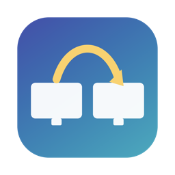
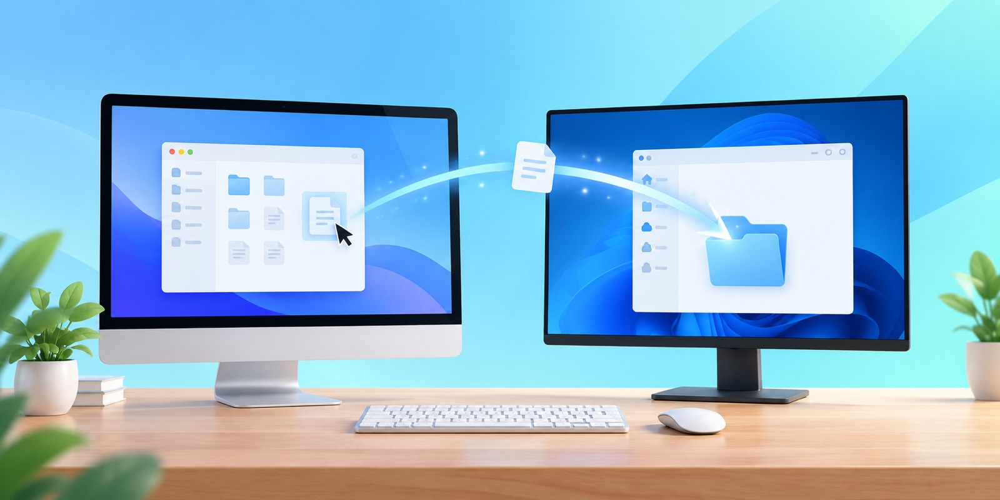
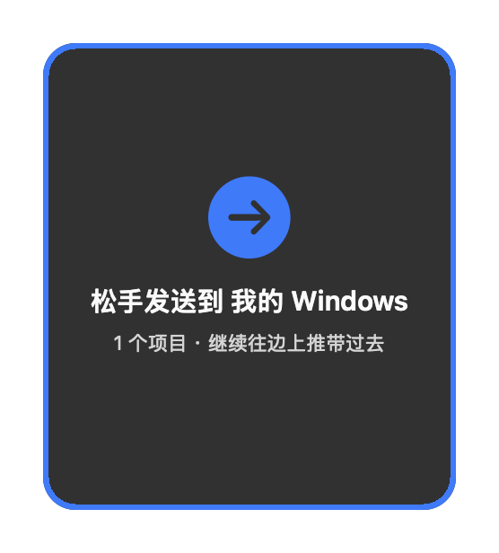
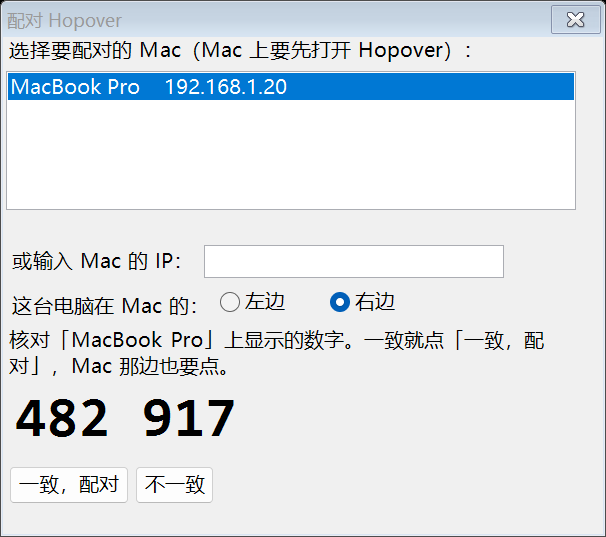
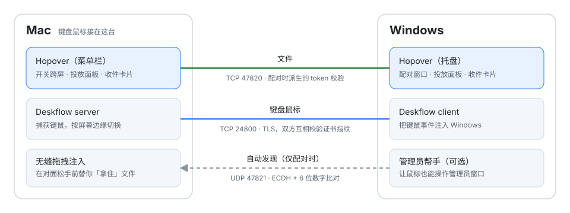

<h1 align="center">Hopover</h1>

  <b>Mac 和 Windows 共用一套键盘鼠标，文件直接拖过屏幕边缘。</b> 
  中文 · <a href="README.en.md">English</a>

  
  
  
  

桌上放着一台 Mac 和一台 Windows 电脑？Hopover 让它们像一台电脑的两块屏幕：

- 鼠标划过屏幕边缘，就到了另一台电脑上，键盘也跟着过去。
- 拖着文件划过边缘，直接放进对面的**任意文件夹**，不用先传到「下载」再去找。
- 两台电脑在同一个局域网里直连，不注册账号，不经过云端。

  <a href="https://github.com/zuiho-kai/hopover/releases/latest"><b>⬇ 下载最新版</b></a> ·
  <a href="https://hopover.pages.dev">官网</a> ·
  <a href="#三步上手">三步上手</a> ·
  <a href="#常见问题">常见问题</a>

---

## 它能做什么

### 一套键鼠，两台电脑

在 Mac 上**双击 ⌃ Control** 打开跨屏，Mac 的鼠标划过边缘就到了 Windows，键盘也跟着过去；再双击一次就关掉，鼠标不会再溜过去。锁屏时会自动关闭。

**两台都有鼠标也行**（0.9.2 起）：Windows 的鼠标往 Mac 那边推出屏幕，就到了 Mac 上，也能拖着文件过去。动一下 Mac 的鼠标，Windows 的鼠标就回到只管 Windows。

### 文件拖过去，放进任意文件夹

<table>
  <tr>
    <td align="center" width="50%"></td>
    <td align="center" width="50%"></td>
  </tr>
  <tr>
    <td align="center">拖着文件靠近边缘，出现投放面板。 继续往边上推，文件就跟着鼠标过去了。</td>
    <td align="center">在对面任意文件夹松手即可。 没找到地方松手？文件也会留在一张卡片里。</td>
  </tr>
</table>

- 两个方向都行：Mac → Windows，Windows → Mac。
- 千兆局域网实测约 **110 MB/s**。拖大文件到 Windows 时，如果松手时还没传完，会显示进度，传完自动放下。
- 拖过去又后悔了？不松手拖回来就行。

### 只想传文件，也可以

不开跨屏时，把文件拖到屏幕边缘的面板上松手，对面屏幕边上会出现一张卡片：单击打开所在位置，也可以把卡片直接拖进任意文件夹。这个用法**不需要任何系统权限**。

---

## 三步上手

**1. 两台都装上**

| | 要求 | 安装 |
|---|---|---|
| **Mac** | Apple 芯片，macOS 14 或更新 | 打开 `Hopover-…-macos-arm64.dmg`，把 Hopover 拖进「应用程序」，再打开它 |
| **Windows** | Windows 10 / 11，64 位 | 把 `Hopover-…-windows-x64.zip` 解压到一个固定位置，双击 `Hopover.exe` |

> 预览版还没有做苹果公证和 Windows 代码签名，第一次打开会被系统拦一下：
> Mac 上到「系统设置 → 隐私与安全性」点 **仍要打开**；Windows 上点 **更多信息 → 仍要运行**。

**2. 配对一次**

Windows 第一次打开会弹出配对窗口，自动找到局域网里的 Mac：

1. 选中你的 Mac。
2. 选这台 Windows 在 Mac 的左边还是右边。
3. 两边会显示同一个 6 位数字，核对一致后，两边都点确认。

不用填 IP，不用注册。以后开机两边会自动连上。

 

**3. 开始用**

- 在 Mac 上**双击 ⌃ Control** 打开跨屏。第一次会请你打开「辅助功能」权限，照提示做，打开后自动接上。
- 鼠标划到 Windows，正常用。拖文件过边缘，放进任意文件夹。
- 在 Windows 上双击 Ctrl，或回到 Mac 再双击 ⌃，都能关掉跨屏。

---

## 常见问题

<b>为什么要「辅助功能」权限？</b>

捕获键盘鼠标、把它们送到另一台电脑，以及拖文件时替你「拿住」文件，都要用到 macOS 的辅助功能权限，这是系统的硬性要求。只用卡片传文件的话，不需要这个权限。

<b>鼠标停在 Windows 的管理员窗口上动不了？</b>

Windows 不允许普通程序操作「以管理员身份运行」的窗口。在 Windows 托盘图标的菜单里选 **「让鼠标也能操作管理员窗口…」**，同意一次授权即可（0.9.1 起）。

<b>安全吗？</b>

- 配对用 ECDH 密钥交换 + 两边核对 6 位数字，密钥从不在网络上传输。
- 键盘鼠标通道用 TLS，两边互相校验对方的证书指纹，你在 Windows 上打的密码不会明文经过局域网。
- 文件通道要用配对时派生的 token 才能连接；文件名里有 `..` 之类的路径会被拒收。

<b>文件存到哪里了？</b>

拖进文件夹的，就在你松手的那个文件夹里。没有松手到文件夹的，在「下载」里，同时显示卡片。接收文件夹可以在菜单栏 / 托盘菜单里改。

<b>遇到问题怎么反馈？</b>

请开一个 [Issue](https://github.com/zuiho-kai/hopover/issues)，附上两边的日志：

- Mac：`~/Library/Logs/Hopover/hopover.log`、`deskflow.log`
- Windows：`%APPDATA%\Hopover\hopover.log`、`%APPDATA%\Hopover\deskflow\client.log`

### 当前限制

- 一台 Mac + 一台 Windows，在同一个局域网里。
- 键盘只能用 Mac 的跨过去；Windows 的鼠标能用在 Mac 上，Windows 的键盘暂时还不行。
- 只支持 Apple 芯片的 Mac。Intel Mac 在计划中。

---

## 更新记录

**0.9.2**
- 新增：Windows 的鼠标也能划到 Mac 上用，并能把文件无缝拖进 Mac 的任意文件夹。
- 修复：关掉 Windows 上的 Hopover 后，鼠标仍在同步。
- 修复：用 Windows 的鼠标把文件推到边缘没反应；现在会立刻发过去。
- 修复：Mac 拖到 Windows 后不松手拖回来，Windows 上的拖拽一直挂着。
- 改进：鼠标穿过边缘更跟手（等待从 250ms 缩到 100ms）；日志超过 1MB 自动轮换。

**0.9.1**
- 修复：Mac 上偶尔一次开不了跨屏，要关掉再开（macOS 27 上内置 Deskflow 偶发崩溃）。
- 修复：Mac 拖到 Windows 时，文件偶尔被弹回 Mac；手快时没接住，还会点到 Windows 上的其他程序。
- 修复：拖过去不松手又拖回 Mac，Windows 那边的拖拽一直挂在鼠标上。
- 新增：Windows 上可以操作管理员窗口（托盘菜单里开启）。
- 改进：鼠标穿过边缘更跟手（等待时间从 250ms 缩到 100ms）。
- 改进：日志超过 1MB 自动轮换。

**0.9.0** — 第一个公开预览版。

---

## 技术细节

- **键盘鼠标**由内置的 [Deskflow](https://github.com/deskflow/deskflow)（GPL-2.0）负责，作为独立进程运行：Mac 上是 server，Windows 上是 client。配置和证书由 Hopover 生成，打开跨屏时才启动，关闭时退出。
- **文件**走 Hopover 自己的 TCP 协议（端口 47820）：先发描述头，对方回 `READY` 后再传内容，写入 `*.hopover-part`，传完再改名。
- **无缝拖拽**：Deskflow 在系统输入最前端截获鼠标，对面电脑并不知道按键还按着。Hopover 在光标到达的那一刻，替你注入一次真实的按下，开始一次系统原生的拖拽；你在对面真正松手时，这次拖拽才结束。Windows 上用 OLE 拖放，Mac 上用 AppKit 拖拽会话。
- **配对**：Windows 在 UDP 47821 上广播发现 Mac；双方做 ECDH P-256 并先提交承诺，6 位数字 = SHA-256(共享密钥 ‖ 双方消息) 截断后取模；token 由共享密钥 HMAC 派生。双方各自生成 TLS 证书，只交换指纹。
- **管理员窗口**（Windows）：普通程序的输入会被 UIPI 挡住。开启后，由一个计划任务以管理员权限运行帮手进程，代为托管 Deskflow client 和注入输入；主程序仍以普通权限运行，这样拖文件进资源管理器不受影响。

## 许可

Hopover 预览版免费使用，Hopover 本身不开源。

Hopover 内置 [Deskflow](https://github.com/deskflow/deskflow) 1.27.0（GPL-2.0），以独立进程运行：

- **Windows 版**内置未修改的 Deskflow。
- **Mac 版**内置的 `deskflow-core` 打了一个补丁：把所有输入法（TIS/TSM）调用放到主线程执行，修复 macOS 27 上的偶发崩溃。

对应的完整源码（`deskflow-1.27.0-source.tar.gz`）和补丁文件（`deskflow-1.27.0-tis-main-thread.patch`）随每个 Release 附带，许可证全文见安装包内的 `LICENSE-GPL-2.0.txt`。
